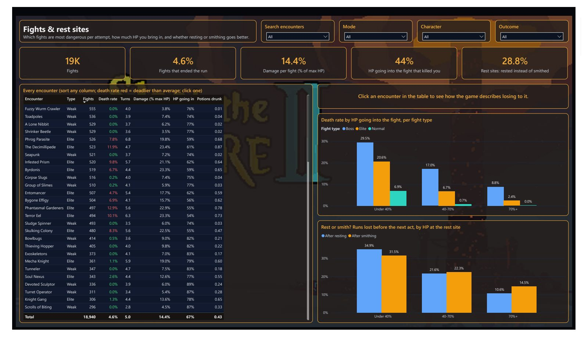
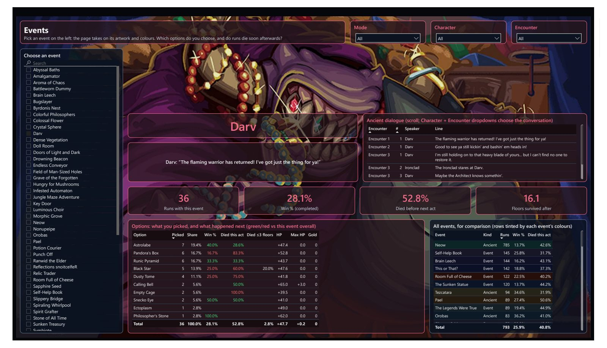
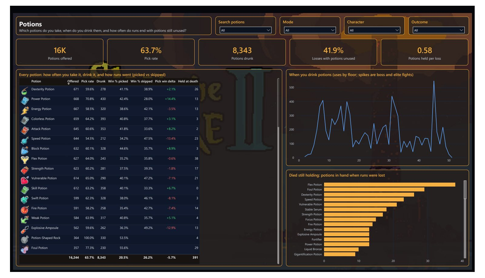
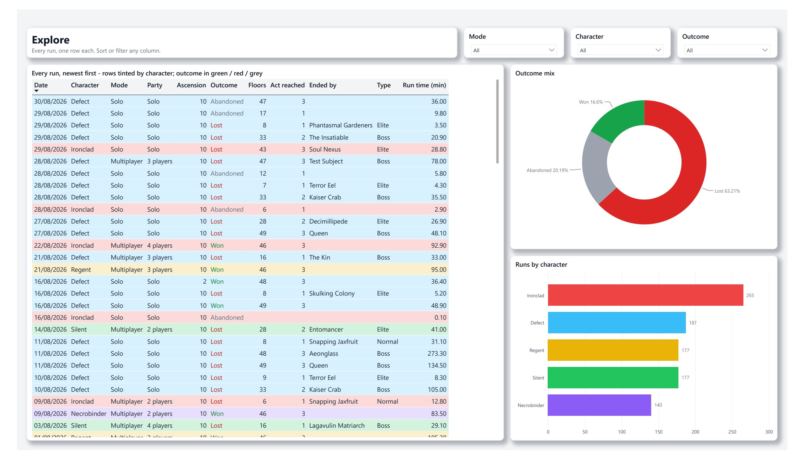

# STS2 BI pipeline: end-to-end audit

_Re-audit: 12-13 Oct 2026 (first audit 11 Oct)  |  Scope: local save files to Power BI report  |  Branch: main (PR #1 merged 12 Oct)_

## Summary

The pipeline is correct end to end and now complete: all 1,061 runs on disk reconcile through GCS, the raw BigQuery tables, the dbt marts and the Power BI model, and the report's headline numbers match independent BigQuery queries exactly. 167 dbt checks run on every build (166 pass, 1 expected warning), the daily build is now live on main, and every finding rated High or Medium in the first audit is closed. This audit found one significant gap and fixed it: the game saves modded play in a separate folder that the uploader never read, so 115 runs (11%, including every run since 30 Aug) were missing. Loading that backlog exposed a related weakness, also fixed: with a single loader instance and no retry policy, bursts of uploads were silently dropped. What remains is low-risk tidying plus one scalability item: each run now takes the loader about a minute.

### Status by stage

| Stage | Status | Verdict |
|---|---|---|
| 1. Extraction (local saves + uploader) | GREEN | Vanilla and modded save trees read; 1,061 files, 0 pending |
| 2. Scheduling (Task Scheduler) | GREEN | Monthly with catch-up on; next run 1 Nov; needs the PC on |
| 3. Landing (GCS) | GREEN | 1,061 objects (115 modded), 62.2 MB |
| 4. Transform + load (Cloud Function) | AMBER | Correct, least-privilege, alerting, retries; ~1 min per run limits backlog speed |
| 5. Raw warehouse (BigQuery sts2) | GREEN | 1,061 runs, no duplicate keys, partitioned + clustered |
| 6. Modelling + tests (dbt) | GREEN | 167 checks: 166 pass, 1 expected warning; contracts on all marts |
| 7. CI / access (GitHub Actions, IAM) | AMBER | Daily build live and keyless; 1p budget alert; default compute SA still holds Editor |
| 8. Semantic model + report (Power BI) | GREEN | Reads sts2_marts (+ local art only); star schema; numbers reconcile |
| 9. Repo hygiene + docs | GREEN | No secrets, raw data, cache or art files tracked (screenshots: F20); docs current |

### Priority actions

| When | Actions |
|---|---|
| Done | F15 modded saves loaded and tagged; F16 retry policy; F10 1p budget alert; F1-F3, F5, F6, F9, F13 from the first audit |
| Next | F17 batch the loader (or ELT); F18 dev target for local dbt; F4 remove Editor from the default SA |
| Later | F7 catalogues into dbt; F11 scope dbt-runner; F8 all players' characters |

## Reconciliation chain

| Check | Result | Source |
|---|---|---|
| Local .run files (profile1, vanilla + modded) | 946 + 115 = 1,061 | File count; profile2 excluded by decision |
| Uploader manifest entries | 1,061 | scripts/uploaded_manifest.json; 0 pending |
| GCS objects (raw/, raw/modded/) | 1,061 | 62.2 MB total |
| Raw sts2.fact_run rows / distinct run_id | 1,061 / 1,061 | BigQuery |
| Mart dim_run rows (Vanilla / Modded) | 1,061 (946 / 115) | BigQuery |
| Power BI Total Runs (no slicers) | 1,061 | Power BI engine (DAX) |
| Win rate: BigQuery vs report | 15.9% / 15.9% | 169 wins / 1,061 runs |
| Win rate (completed): BigQuery vs report | 20.1% / 20.1% | 169 / (1,061 - 221 abandoned) |
| Avg floors reached: BigQuery vs report | 23.4 / 23.4 | dim_run.floors_reached |
| Avg death floor: BigQuery vs report | 20.8 / 20.8 | dim_run.death_floor |
| Event choices: BigQuery vs report | 9,541 / 9,541 | fct_event_choice |
| Potion events: BigQuery vs report | 26,317 / 26,317 | fct_potion_event |
| Fights: BigQuery vs report | 18,940 / 18,940 | fct_combat |
| Rest-site choices: BigQuery vs report | 6,606 / 6,606 | fct_rest_choice |

Child facts legitimately cover fewer runs than dim_run (1,061): floor states 1,055 (runs abandoned within seconds have no floors - tested and excluded), fights 1,034, card choices 1,030, event choices 1,045. Date range 2026-03-05 to 2026-10-12.

## Strengths

- Full reconciliation: 1,061 runs at every stage from disk to dashboard; four headline KPIs and four fact-table row counts match independent BigQuery queries exactly.
- 167 dbt checks on every build: strict source tests, referential integrity from every fact to its dimensions, grain-uniqueness tests, enforced contracts on every mart, and domain checks.
- Layered warehouse: raw sts2 (loader-owned) -> sts2_staging (views) -> sts2_marts (tested tables). Power BI reads only sts2_marts for data; game artwork is a local presentation asset, never committed.
- Clean star schema around dim_run: every fact relates to dimensions, never to another fact.
- Second data source done properly: reference data (cards, events, relics, potions, encounters, Ancient dialogue) is read from the installed game files, replacing a wiki scrape whose terms forbade it.
- Operability: fail-fast uploader, least-privilege loader account, log-based alerting, retry policy, and an idempotent loader that makes any reprocessing safe.
- Keyless CI: GitHub Actions uses Workload Identity Federation restricted to this repository; the daily dbt build now runs from main.
- Cost: well inside free tiers (MB-scale GCS and BigQuery, free GitHub Actions on a public repo).

## Findings

Closed since the first audit: F1 (bucket variable set, uploader fails fast), F2 (missed runs caught up), F3 (log-based alerting; plus F16 retries), F5 (PR #1 merged, daily build live), F6 (300 s timeout), F9 (manifest saved per file), F13 (docs corrected), and the wiki-scrape terms issue (reference data now read from the game's own files).

### F15 - High - Extraction - Resolved

The game writes modded play to a separate save tree (steam/<id>/modded/profile1/saves/history) that the uploader never read: 115 runs from May to 12 Oct were missing, including every run since 30 Aug.

- **Evidence:** Newest run in the vanilla folder 30 Aug; 115 files in the modded folder, none in the manifest or GCS.
- **Recommendation:** Done: the uploader reads profile1 from both trees, runs are tagged save_source (Vanilla / Modded) from their GCS path and exposed in dim_run; profile2 (10 old test runs) excluded by the owner's choice.
- **Effort:** Done

### F16 - Medium - Cloud Function - Resolved

With max-instances=1 and RETRY_POLICY_DO_NOT_RETRY, deliveries arriving while the instance was busy were aborted ('no available instance') and the runs silently dropped.

- **Evidence:** Cloud Run warnings on 11 Oct and again during the backlog upload.
- **Recommendation:** Done: trigger redeployed with --retry; safe because the loader is idempotent per run_id.
- **Effort:** Done

### F17 - Medium - Cloud Function - Open

Each run costs the loader ~28 sequential BigQuery jobs (delete + load for 13 tables, 2 catalogue MERGEs), about a minute per run with one instance, so the 115-run backlog took around two hours to drain. Fine for monthly volumes, slow for backfills.

- **Evidence:** Observed load rate during the backlog: about one run per minute.
- **Recommendation:** Batch per run (one multi-statement transaction, or load all tables then one DELETE per table), or move flattening into dbt (true ELT) so the function only lands files. For one-off backfills, scripts/backfill_table.py already loads a whole table in one job.
- **Effort:** 2-4 h

### F18 - Low - dbt / CI - Open

Local dbt builds write to the same datasets as CI. A local build running at the same moment as a PR workflow briefly replaced a seed table, and the CI run failed ('relic_catalog was not found').

- **Evidence:** PR run 38317686459 failed at 22:38 while a local build ran; the run on main a minute later passed.
- **Recommendation:** Add a dev target writing to sts2_dev_* datasets for local work; keep the shared datasets for CI.
- **Effort:** 30 min

### F19 - Low - Cloud Function - Resolved

One 4-player modded run made a 'Key Door' event choice on a boss floor, where the room records only the fight, so the choice had no event_id. The strict not_null source test stopped the build.

- **Evidence:** source_not_null_sts2_fact_event_choice_event_id: FAIL 4 (one run, four players).
- **Recommendation:** Done: flatten.py falls back to the event named in the choice key; table reloaded, loader redeployed, all tests pass. A good example of a strict source test catching new data.
- **Effort:** Done

### F4 - Low - IAM - Partly resolved

The loader now runs as a dedicated least-privilege account, but the default compute service account still holds roles/editor (plus BigQuery and Storage roles) although nothing uses it.

- **Evidence:** Project IAM policy.
- **Recommendation:** Remove Editor and the unused grants from 448620880316-compute@... .
- **Effort:** 5 min

### F7 - Low - Cloud Function - Open

Card and relic catalogues are still MERGEd by the loader; this raced under concurrency once and is why max-instances must stay at 1 (and part of F17).

- **Evidence:** cloud_function/main.py _upsert_dimensions.
- **Recommendation:** Derive the catalogues in dbt from the facts and drop the MERGE; concurrency can then rise.
- **Effort:** 1-2 h

### F8 - Low - Cloud Function - Partly resolved

Deprecated utcfromtimestamp fixed; fact_run.character still only captures players[0].

- **Evidence:** cloud_function/flatten.py.
- **Recommendation:** Model all players' characters (fct_run_player) when co-op analysis matters.
- **Effort:** 30 min

### F10 - Low - Cost / ops - Resolved

There was no budget alert for the project.

- **Evidence:** Budget 'STS2 BI - any spend (1p)': GBP 0.01/month on sts2-bi-1995ebj, alerts at 100% of actual and forecast spend (gcloud stored 0.01GBP as 1 nano-pound; corrected via the API and verified).
- **Recommendation:** Done 13 Oct: any spend at all emails the billing admins. Budgets alert, they don't cap.
- **Effort:** Done

### F11 - Low - IAM - Open

dbt-runner holds bigquery.dataEditor at project level rather than on the datasets it uses.

- **Evidence:** Project IAM policy.
- **Recommendation:** Scope to sts2 (read) and sts2_staging / sts2_marts (write).
- **Effort:** 15 min

### F20 - Info - Repo - Open

Seeds include short game text from Mega Crit's localization (event, option, potion and encounter text, Ancient dialogue). Artwork files are extracted locally and never committed, but the report PDF and screenshots in docs/ show the artwork as page backgrounds.

- **Evidence:** dbt/seeds/*.csv; powerbi/assets/ is gitignored; docs/report.pdf and docs/screenshots/*.jpg.
- **Recommendation:** Acceptable for a non-commercial portfolio; if asked, regenerate the text columns locally and export the report without background art (or drop the screenshots).
- **Effort:** -

### F12 - Info - Power BI - Accepted

Refresh is manual in Desktop; scheduled refresh needs a Pro licence.

- **Evidence:** No published dataset.
- **Recommendation:** Accepted for a personal project.
- **Effort:** -

### F14 - Info - dbt - Accepted

3 cards appear in runs but not in the current game files (Grapple, Follow Through, Scare - retired). Reported by the warn-level coverage test, as designed.

- **Evidence:** assert_cards_in_catalog: WARN 3.
- **Recommendation:** No action; re-run scripts/build_reference_seeds.py after game patches.
- **Effort:** -

## Method

Each stage was checked against live systems: local save folders and Task Scheduler (PowerShell, schtasks), GCS contents and Cloud Function configuration and logs (gcloud), IAM policy and alert policies, row counts and KPI queries in BigQuery, a full dbt build, GitHub Actions run history, and the Power BI model queried directly through its local Analysis Services engine, plus the rendered report.

## Appendix: report pages

