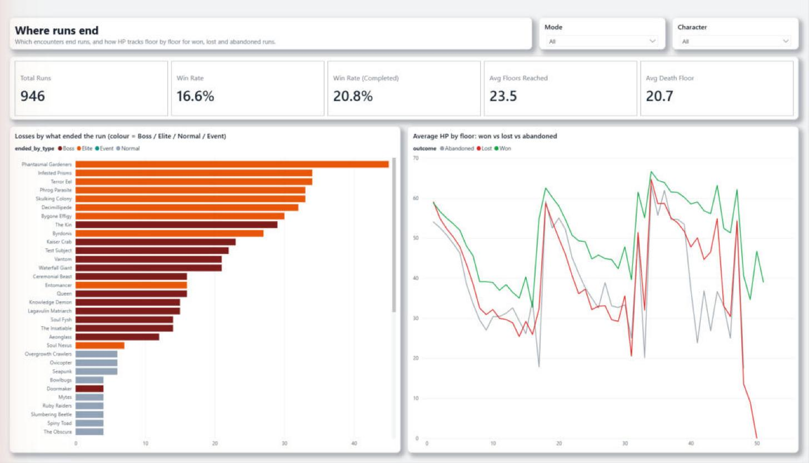
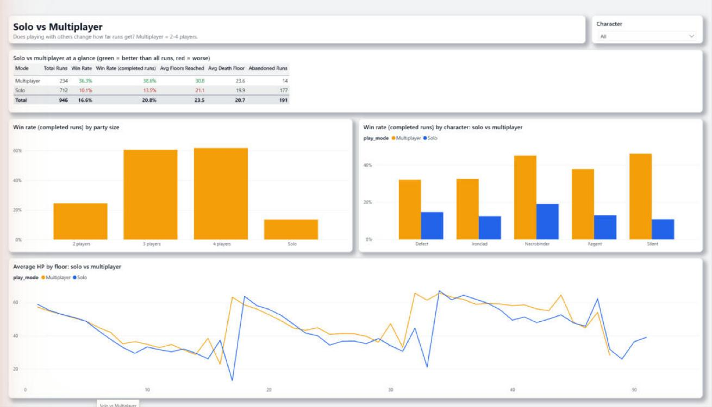
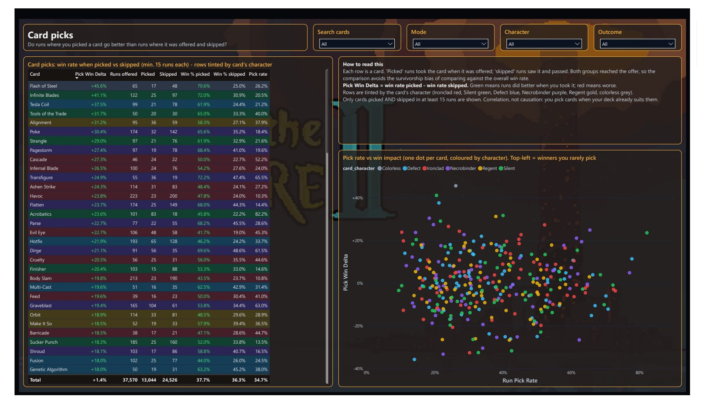

# STS2 BI pipeline: end-to-end audit

_Audit date: 11 Oct 2026  |  Scope: local save files to Power BI report  |  Branch: claude/sts2-data-review-ykxfnt_

## Summary

The pipeline is correct end to end: every one of the 946 runs on disk reconciles through GCS, the raw BigQuery tables, the dbt marts and the Power BI model, and the dashboard's headline numbers match independent BigQuery queries exactly. Data quality is enforced by 82 passing dbt checks, the semantic model reads only the tested marts, and CI authenticates to GCP without any stored key. The weak points are operational rather than analytical: the local uploader is misconfigured and will fail on the next new run, failed loads would be dropped silently, and the Cloud Function runs with an over-privileged default service account.

### Status by stage

| Stage | Status | Verdict |
|---|---|---|
| 1. Extraction (local saves + uploader) | RED | Bucket env var missing: next upload with new runs will fail |
| 2. Scheduling (Task Scheduler) | AMBER | Runs monthly; missed runs are not caught up |
| 3. Landing (GCS) | GREEN | 946 objects, 55.9 MB, matches local exactly |
| 4. Transform + load (Cloud Function) | AMBER | Correct output; silent-failure and privilege risks |
| 5. Raw warehouse (BigQuery sts2) | GREEN | 946 runs, no duplicate keys, partitioned + clustered |
| 6. Modelling + tests (dbt) | GREEN | 82 checks pass, 1 expected warning; contracts on all marts |
| 7. CI / access (GitHub Actions, IAM) | AMBER | Keyless and green, but daily schedule inactive until merge |
| 8. Semantic model + report (Power BI) | GREEN | Reads only sts2_marts; star schema; numbers reconcile |
| 9. Repo hygiene + docs | GREEN | No secrets or raw data committed; one stale statement |

### Priority actions

| When | Actions |
|---|---|
| Now | F1 set STS2_GCS_BUCKET + fail fast; F2 tick catch-up in Task Scheduler; F5 merge PR #1 |
| Next | F3 error alerting; F4 dedicated least-privilege loader service account; F6 raise timeout |
| Later | F7 move catalogs into dbt; F8 code tidy-ups; F10 budget alert; F11 scope dbt-runner |

## Reconciliation chain

| Check | Result | Source |
|---|---|---|
| Local .run files (save folder) | 946 | PowerShell file count |
| Uploader manifest entries | 946 | scripts/uploaded_manifest.json; 0 pending |
| GCS objects (gs://sts2-runs-1995ebj/raw/) | 946 | gcloud storage ls; 55.9 MB total |
| Raw sts2.fact_run rows / distinct run_id | 946 / 946 | BigQuery |
| Mart sts2_marts.dim_run rows | 946 | BigQuery |
| Power BI Total Runs (no slicers) | 946 | Report KPI card |
| Win rate: BigQuery vs report | 16.6% / 16.6% | 157 wins / 946 runs |
| Win rate (completed): BigQuery vs report | 20.8% / 20.8% | 157 / (946 - 191 abandoned) |
| Avg floors reached: BigQuery vs report | 23.5 / 23.5 | dim_run.floors_reached |
| Avg death floor: BigQuery vs report | 20.7 / 20.7 | dim_run.death_floor |

Child fact tables legitimately cover fewer runs than fact_run: fct_floor_state 941 (5 runs abandoned within 3 seconds have no floors - tested and excluded), fact_card_choice 925, fact_cards_gained 930, fact_deck_card 945, fact_relic 946. Date range 2026-03-05 to 2026-08-30; newest local run 30 Aug 2026.

## Strengths

- Full reconciliation: 946 runs at every stage from disk to dashboard, and four headline KPIs match independent BigQuery queries exactly.
- 82 dbt checks pass: strict source tests (which would have caught the historical duplicate-card bug), referential integrity from every fact to its dimensions, grain-uniqueness tests, enforced contracts on all marts, and domain checks (HP bounds, run_date vs run_id, accepted values).
- Layered warehouse: raw sts2 (loader-owned) -> sts2_staging (views) -> sts2_marts (tested tables). Power BI reads only sts2_marts (all 10 partitions verified).
- Clean star schema: 12 relationships, every one fact -> dimension; dim_run is the hub, no fact-to-fact joins.
- Two data sources: run data plus a reproducible card catalog seed (568/571 cards matched exactly, 99.7% of offers), with a coverage monitor.
- Keyless CI: GitHub Actions uses Workload Identity Federation restricted to this repository; the dbt-runner service account has zero user-managed keys.
- Repo hygiene: no secrets, keys, raw .run files, local manifest or Power BI cache files are tracked.
- Cost: well inside free tiers (55.9 MB in GCS, MB-scale BigQuery, free GitHub Actions on a public repo).

## Findings

### F1 - High - Extraction

STS2_GCS_BUCKET is not set at user, machine or process scope, so upload_to_gcs.py falls back to the placeholder 'REPLACE_WITH_YOUR_BUCKET_NAME'. The 1 Sep run only succeeded because there were no new files.

- **Evidence:** Env var empty in all scopes; registry HKCU\Environment has no value; uploader line 30.
- **Recommendation:** Set it permanently (setx STS2_GCS_BUCKET sts2-runs-1995ebj) and make the uploader fail fast with a clear error when the variable is missing instead of using a placeholder.
- **Effort:** 5 min

### F2 - Medium - Scheduling

Missed monthly runs are never caught up (StartWhenAvailable = False) and the task only runs while the user is logged in. October's run was missed (no data lost: no new runs since 30 Aug).

- **Evidence:** schtasks: last run 01/09/2026, next 01/11/2026; NumberOfMissedRuns 1.
- **Recommendation:** Tick 'Run task as soon as possible after a scheduled start is missed' (needs admin, so done by hand). Optionally point the action at a stable Python path instead of the version-pinned Store path.
- **Effort:** 2 min

### F3 - Medium - Cloud Function

Failed loads are dropped silently: the trigger is RETRY_POLICY_DO_NOT_RETRY, there is no dead-letter or alerting, and logs are retained 30 days, so there is currently no execution history at all.

- **Evidence:** gcloud logging read returned no entries for the last 60 days; retryPolicy DO_NOT_RETRY.
- **Recommendation:** Add a log-based alert on function errors (email), or a dbt/BigQuery reconciliation check comparing GCS object count with fact_run rows.
- **Effort:** 30 min

### F4 - Medium - Cloud Function / IAM

The function runs as the default compute service account, which holds roles/editor on the project - far broader than it needs.

- **Evidence:** IAM policy: 448620880316-compute@... has roles/editor plus BigQuery and Storage roles.
- **Recommendation:** Create a dedicated sts2-loader service account with bigquery.dataEditor (sts2 dataset), bigquery.jobUser and storage.objectViewer (bucket), redeploy with --service-account, remove Editor from the default SA.
- **Effort:** 20 min

### F5 - Medium - CI

The daily dbt schedule is not active: scheduled workflows only run from the default branch and the work is still on PR #1. PR-triggered runs are green (5 of 5).

- **Evidence:** gh run list: all runs event=pull_request, success; PR #1 OPEN, mergeable.
- **Recommendation:** Merge PR #1 into main.
- **Effort:** 1 min

### F6 - Low - Cloud Function

Timeout is 60s while each run executes ~14 sequential BigQuery jobs (6 DELETE, 6 load, 2 MERGE). Never observed failing, but with no retained logs the margin is unverified.

- **Evidence:** serviceConfig.timeoutSeconds = 60.
- **Recommendation:** Raise the timeout to 300s.
- **Effort:** 2 min

### F7 - Low - Cloud Function

Dimension upserts (dim_card/dim_relic MERGE) live in the loader. They raced under concurrency and created duplicates; this is mitigated by --max-instances=1 and strict dbt source tests, but caps throughput.

- **Evidence:** Historical incident (38 duplicate cards); max-instances=1.
- **Recommendation:** Derive catalogs in dbt from the facts and drop the MERGE from the function; then concurrency can rise. See docs/roadmap.md.
- **Effort:** 1-2 h

### F8 - Low - Cloud Function

fact_run.character only captures players[0]; datetime.utcfromtimestamp is deprecated in Python 3.12; the raw column acts_completed is len(acts) (always 3), not progress.

- **Evidence:** cloud_function/main.py lines 44, 50, 61.
- **Recommendation:** Use datetime.fromtimestamp(ts, UTC); capture all players' characters (fct_run_player). acts_completed is already superseded by dim_run.acts_reached / floors_reached.
- **Effort:** 30 min

### F9 - Low - Extraction

The uploader writes its manifest only after all uploads finish, so a mid-batch failure re-uploads files next time.

- **Evidence:** scripts/upload_to_gcs.py line 64.
- **Recommendation:** Harmless (the loader is idempotent per run_id) but cheap to fix: save after each upload.
- **Effort:** 5 min

### F10 - Low - Cost / ops

No billing budget alert exists (the Budget API is not enabled).

- **Evidence:** gcloud billing budgets list: API disabled.
- **Recommendation:** Create a GBP 1 budget with email alerts as a safety net.
- **Effort:** 5 min

### F11 - Low - IAM

dbt-runner holds bigquery.dataEditor at project level rather than on the three datasets it uses.

- **Evidence:** IAM policy bindings.
- **Recommendation:** Scope dataEditor to sts2 (read) and sts2_staging / sts2_marts (write).
- **Effort:** 15 min

### F12 - Low - Power BI

Refresh is manual (Desktop); scheduled refresh needs the Power BI Service with a Pro licence.

- **Evidence:** No published dataset.
- **Recommendation:** Accept for a personal project, or publish and schedule refresh if shared.
- **Effort:** -

### F13 - Low - Docs

CLAUDE.md states STS2_GCS_BUCKET is set via setx; it is not (see F1).

- **Evidence:** CLAUDE.md, Local environment notes.
- **Recommendation:** Correct the note when F1 is fixed.
- **Effort:** 1 min

### F14 - Info - dbt

3 cards appear in runs but not in the card catalog (Grapple, Follow Through, Scare - retired from the current game version). Reported by the warn-level coverage test, as designed.

- **Evidence:** assert_cards_in_catalog: WARN 3.
- **Recommendation:** No action; re-run scripts/fetch_card_catalog.py after game patches.
- **Effort:** -

## Method

Each stage was checked against live systems on the audit date: local files and Task Scheduler (PowerShell/schtasks), GCS and Cloud Functions configuration and logs (gcloud), row counts and KPI queries in BigQuery (bq), a full dbt build, GitHub Actions run history and IAM policy, the Power BI semantic model files (TMDL partitions and relationships) and the rendered report.

## Appendix: report pages

